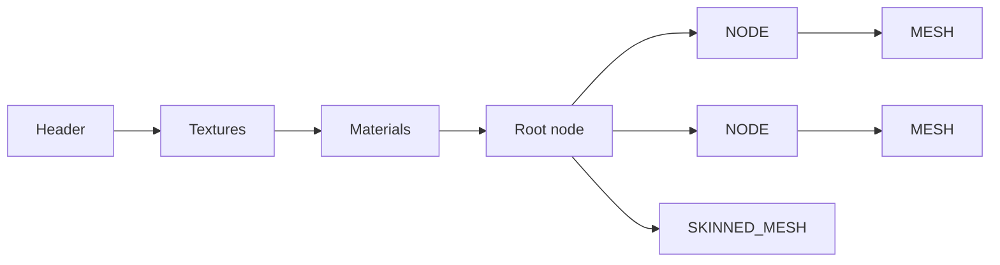

# KN5 file format

KN5 is the binary 3D model format used by Assetto Corsa for **cars and tracks**. One file contains every texture, every material and a tree of nodes holding the meshes.

<div class="grid cards" markdown>

- **Byte order**

    ---

    Little-endian

- :material-ruler: **Offsets**

    ---

    None. Everything is read sequentially, because almost all data is variable-length.

- :material-format-text: **Strings**

    ---

    [ACString](#acstring): a 4-byte length followed by UTF-8 bytes

- :material-file-tree-outline: **Structure**

    ---

    Header, textures, materials, then one recursive node tree

</div>


## At a glance



??? info "Type notation used on this page"

    | Name | Meaning | Size |
    |------|---------|------|
    | `byte` | unsigned 8-bit integer | 1 |
    | `ushort` | unsigned 16-bit integer | 2 |
    | `uint` | unsigned 32-bit integer | 4 |
    | `int` | signed 32-bit integer | 4 |
    | `float` | IEEE 754 single | 4 |
    | `float[16]` | 4×4 matrix | 64 |

    In the **Size** columns, `var` means the size depends on the data and `n` is the element count read just before.

---

## ACString

Every name in the file uses this string type.

| Size | Type | Name | Description |
|------|------|------|-------------|
| 4 | `int` | `size` | Number of **bytes** in `value` |
| `size` | `char[size]` | `value` | UTF-8 text, **not** null-terminated |

!!! note

    `size` counts bytes, not characters. Names may contain UTF-8 symbols.

---

## Header

| Size | Type | Name | Description |
|------|------|------|-------------|
| 6 | `char[6]` | `prefix` | Always `sc6969` |
| 4 | `uint` | `version` | Format version |
| 4 | `uint` | `key` | Only present if `version > 5` |

!!! tip "Which version should I write?"

    Use `version = 5` for new files. Versions above 5 add the `key` field, which is used by cars from paid DLCs for integrity verification.

!!! info "Seen in the wild"

    A track-object file with `version = 6` had `key = 0`, so a version above 5 does not necessarily carry a real key.

---

## Textures

| Size | Type | Name | Description |
|------|------|------|-------------|
| 4 | `uint` | `texturesSize` | Number of textures |
| var | `Texture[texturesSize]` | `textures` | Textures, one after another |

### Texture

| Size | Type | Name | Description |
|------|------|------|-------------|
| 4 | `uint` | `state` | Always `1` |
| var | `ACString` | `name` | Texture file name, for example `lights.dds` |
| 4 | `uint` | `size` | Size of the texture data in bytes |
| `size` | `byte[size]` | `data` | The complete texture file, embedded as is |

!!! info "Textures are whole files"

    In the sample, `data` starts with `DDS `, the magic of a DDS file. You can write it out unchanged to get the original texture back.

---

## Materials

| Size | Type | Name | Description |
|------|------|------|-------------|
| 4 | `uint` | `materialsSize` | Number of materials |
| var | `Material[materialsSize]` | `materials` | Materials, one after another |

### Material

| Size | Type | Name | Description |
|------|------|------|-------------|
| var | `ACString` | `name` | Material name |
| var | `ACString` | `shader` | Shader name, for example `ksPerPixel` |
| 1 | `byte` | `blend` | Blend mode |
| 1 | `byte` | `alpha_tested` | Alpha test enabled |
| 4 | `uint` | `depth_mode` | Depth mode |
| 4 | `uint` | `propertiesSize` | Number of properties |
| var | `MaterialProperty[propertiesSize]` | `properties` | Shader properties |
| 4 | `uint` | `resourcesSize` | Number of resources |
| var | `MaterialResource[resourcesSize]` | `resources` | Texture bindings |

=== "MaterialProperty"

    Every property stores the same 10 floats, whichever one the shader actually uses.

    | Size | Type | Name | Description |
    |------|------|------|-------------|
    | var | `ACString` | `name` | Property name |
    | 4 | `float` | `v1` | Scalar value |
    | 8 | `float[2]` | `v2` | Vector2 value |
    | 12 | `float[3]` | `v3` | Vector3 value |
    | 16 | `float[4]` | `v4` | Vector4 value |

=== "MaterialResource"

    | Size | Type | Name | Description |
    |------|------|------|-------------|
    | var | `ACString` | `name` | Resource name, for example `txDiffuse` |
    | 4 | `uint` | `slot` | Texture slot |
    | var | `ACString` | `texture` | Name of the texture (matches `Texture.name`) |

=== "Example: `lights`"

    Shader `ksPerPixel`, `blend = 0`, `alpha_tested = 0`, `depth_mode = 0`.

    | Property | `v1` | `v2`, `v3`, `v4` |
    |----------|------|------------------|
    | `ksAmbient` | 0.588 | all 0 |
    | `ksDiffuse` | 0.588 | all 0 |
    | `ksSpecular` | 0.9 | all 0 |
    | `ksSpecularEXP` | 10 | all 0 |
    | `ksEmissive` | 0 | all 0 |
    | `ksAlphaRef` | 0 | all 0 |

    One resource: `txDiffuse`, slot `0`, texture `lights.dds`.

    Scalar properties use only `v1`, the other floats are zero.

---

## Nodes

The file ends with a single **root node**. Nodes form a tree, and only `NODE` entries have children.

| Value | Name | Meaning |
|-------|------|---------|
| `1` | `NODE` | Parent node with a transformation |
| `2` | `MESH` | Regular mesh, no transformation |
| `3` | `SKINNED_MESH` | Skinned mesh |

!!! info "Reading order"

    The tree is read depth-first. A `NODE` is followed immediately by its children, so there is no child table or offset to jump to.

!!! example "What a real tree looks like"

    ```text
    NODE  "FBX: finish200.FBX"      identity transform, 2 children
    ├── NODE  "AC_OPEN_FINISH_L"    1 child
    │   └── MESH  "AC_OPEN_FINISH_L"
    └── NODE  "AC_OPEN_FINISH_R"    1 child
        └── MESH  "AC_OPEN_FINISH_R"
    ```

    The root is a `NODE` named after the source FBX file. Each mesh sits below its own `NODE`, which positions it, and the mesh itself has `childrenSize = 0`.

### Common fields

Every node starts with these, and the `class` value decides which fields follow.

| Size | Type | Name | Description |
|------|------|------|-------------|
| 4 | `uint` | `class` | `NodeClass`, see table above |
| var | `ACString` | `name` | Node name |
| 4 | `uint` | `childrenSize` | Number of children (used by `NODE`) |
| 1 | `byte` | `active` | Node is active |

### Fields by node class

=== "NODE"

    | Size | Type | Name | Description |
    |------|------|------|-------------|
    | 64 | `float[16]` | `transform` | 4×4 transformation matrix |
    | var | `Node[childrenSize]` | `children` | Child nodes, read recursively |

    !!! info "Matrix layout"

        The 16 floats are stored row by row, and the **translation is in the last row** (floats 12 to 14). The identity matrix therefore looks like this:

        ```text
        1 0 0 0
        0 1 0 0
        0 0 1 0
        0 0 0 1   ← translation x, y, z in the first three
        ```

        In the sample, a node at position `(227.006, -1.101, -21.687)` stores exactly those three values as floats 12, 13 and 14.

=== "MESH"

    | Size | Type | Name | Description |
    |------|------|------|-------------|
    | 1 | `byte` | `castShadows` | |
    | 1 | `byte` | `isVisible` | |
    | 1 | `byte` | `isTransparent` | Transparent meshes are rendered last, without depth testing |
    | 4 | `uint` | `verticesSize` | Number of vertices |
    | 44 × n | `MeshVertex[verticesSize]` | `vertices` | See [vertex layouts](#vertex-layouts) |
    | 4 | `uint` | `indicesSize` | Number of indices |
    | 2 × n | `ushort[indicesSize]` | `indices` | Triangle indices, three per triangle |
    | 4 | `uint` | `materialID` | Index into the material list |
    | 4 | `uint` | `layer` | `0`: always rendered. `1` and higher: depends on the world detail setting. Use `0` for cars. |
    | 4 | `float` | `lodIn` | Not really relevant for cars |
    | 4 | `float` | `lodOut` | Not really relevant for cars |
    | 12 | `float[3]` | `bsCenter` | Bounding sphere center |
    | 4 | `float` | `bsRadius` | Bounding sphere radius |
    | 1 | `byte` | `isRenderable` | `1` normally, `0` for physics-only meshes on tracks |

    !!! example "Sample mesh"

        A unit box, 1 × 1 × 1 with its base on the XY plane: 24 vertices (4 per face) and 36 indices (2 triangles per face), `castShadows = 1`, `isVisible = 1`, `isTransparent = 0`, `layer = 0`, `lodIn = lodOut = 0`.

        The bounding sphere has center `(0, 0, 0.5)` and radius `0.866`, which is the distance from the box center to a corner. So the sphere encloses the whole mesh.

=== "SKINNED_MESH"

    | Size | Type | Name | Description |
    |------|------|------|-------------|
    | 1 | `byte` | `castShadows` | |
    | 1 | `byte` | `isVisible` | |
    | 1 | `byte` | `isTransparent` | Rendered last, without depth testing |
    | 4 | `uint` | `bonesSize` | Number of bones |
    | var | `Bone[bonesSize]` | `bones` | See [Bone](#bone) |
    | 4 | `uint` | `verticesSize` | Number of vertices |
    | 76 × n | `SkinnedMeshVertex[verticesSize]` | `vertices` | See [vertex layouts](#vertex-layouts) |
    | 4 | `uint` | `indicesSize` | Number of indices |
    | 2 × n | `ushort[indicesSize]` | `indices` | Triangle indices |
    | 4 | `uint` | `materialID` | Index into the material list |
    | 4 | `uint` | `layer` | Same as for `MESH` |
    | 4 | `float` | `lodIn` | |
    | 4 | `float` | `lodOut` | |

    !!! warning "Differences from MESH"

        Skinned meshes have **no** bounding sphere and **no** `isRenderable` field.

    !!! note "Not verified"

        The sample file has no skinned meshes, so this layout comes from an existing parser template only.

### Bone

| Size | Type | Name | Description |
|------|------|------|-------------|
| var | `ACString` | `name` | Bone name |
| 64 | `float[16]` | `transform` | 4×4 matrix |

### Vertex layouts

=== "MeshVertex (44 bytes)"

    | Offset | Type | Name |
    |--------|------|------|
    | `0x00` | `float[3]` | `pos` |
    | `0x0C` | `float[3]` | `normal` |
    | `0x18` | `float[2]` | `uv` |
    | `0x20` | `float[3]` | `tangent` |

    In the sample, `normal` and `tangent` are unit length, and the `uv` V values run from `0` to `-1`, so V appears to be flipped.

=== "SkinnedMeshVertex (76 bytes)"

    | Offset | Type | Name | Description |
    |--------|------|------|-------------|
    | `0x00` | `float[3]` | `pos` | |
    | `0x0C` | `float[3]` | `normal` | |
    | `0x18` | `float[2]` | `uv` | |
    | `0x20` | `float[3]` | `tangent` | |
    | `0x2C` | `float[4]` | `weights` | Bone weights |
    | `0x3C` | `float[4]` | `indices` | Bone indices |

    !!! warning

        `indices` are stored as **floats**, not integers.

---

## Worked example

The first bytes of a real file, up to the start of the texture data.

| Bytes | Field | Value |
|-------|-------|-------|
| `73 63 36 39 36 39` | `prefix` | `sc6969` |
| `06 00 00 00` | `version` | 6 |
| `00 00 00 00` | `key` | 0 (present because `version > 5`) |
| `01 00 00 00` | `texturesSize` | 1 |
| `01 00 00 00` | `Texture.state` | 1 |
| `0A 00 00 00` | `name.size` | 10 |
| `6C 69 67 68 74 73 2E 64 64 73` | `name.value` | `lights.dds` |
| `80 54 05 00` | `Texture.size` | 349312 |
| `44 44 53 20 ...` | `data` | `DDS ` and the rest of the DDS file |

And the root node, which starts right after the last material:

| Bytes | Field | Value |
|-------|-------|-------|
| `01 00 00 00` | `class` | 1 (`NODE`) |
| `12 00 00 00` | `name.size` | 18 |
| `46 42 58 3A 20 66 69 6E 69 73 68 32 30 30 2E 46 42 58` | `name.value` | `FBX: finish200.FBX` |
| `02 00 00 00` | `childrenSize` | 2 |
| `01` | `active` | 1 |
| `00 00 80 3F 00 00 00 00 ...` | `transform` | identity matrix, 64 bytes |

---


*[ACString]: Length-prefixed UTF-8 string used throughout KN5
*[LOD]: Level of Detail
*[UV]: Texture coordinates
*[DLC]: Downloadable content
*[FBX]: Autodesk exchange format for 3D scenes