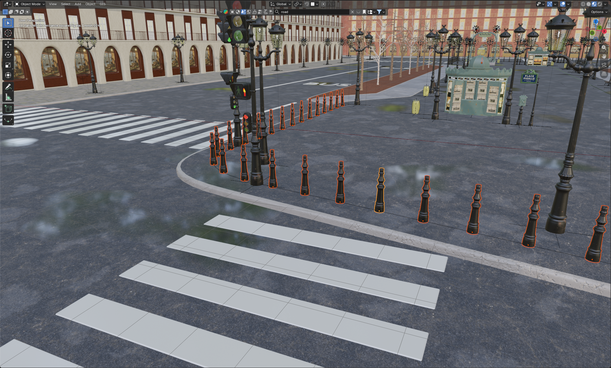

# Combining Meshes

One of the easiest ways to reduce the amount of objects in your scene is by combining meshes that share the same material. This helps with batching and can lower draw calls, which is especially useful for large track scenes.

!!! warning "Don't overdo it"

    Combining everything into one giant mesh will hurt culling (frustum/occlusion). Only combine static objects that you know will stay together and share the same material. Read [draw calls][what-are-draw-calls]{ data-preview } and [culling][what-is-culling]{ data-preview }.

=== "Blender"

    ## Blender

    ### What you'll need

    - Basic knowledge of Blender's Object Mode and Edit Mode

    ### Step 1: Identify what to combine

    Look for static pieces that make sense as one object. Good examples:

    - A modular wall made of multiple separate planks
    - Repeated trim pieces that form one continuous section
    - Scenery props that are always placed as a set and use the same material

    ### Step 2: Select the objects

    </img>

    1. Open your scene in Blender
    2. Switch to **Object Mode** (`Tab` if you're in Edit Mode)
    3. Select all meshes you want to join. Hold `Shift` and click each one

    ### Step 3: Join them together

    1. With all objects selected, press `Ctrl + J` on your keyboard
    2. Blender will merge them into one single object

    !!! tip "Tip"

        You can also find this under `Object > Join` in the top bar.

    ### Step 4: Clean up

    !!! info "Info"

        This is only necessary when you join meshes that "touch" each other, like two walls and should be done with care, as it can also break stuff.

    1. Enter **Edit Mode** (`Tab`)
    2. Remove doubles: `M > By Distance` (this merges overlapping vertices)
    3. Recalculate normals if needed: `Shift + N` (especially after joining hard-surface pieces)
    4. Exit Edit Mode (`Tab`)

    ### Important Notes for Blender

    - **Don't join across different materials unnecessarily**: If you plan to merge materials later, that's fine. But joining objects just to "clean up" when they need different materials isn't helpful for draw calls.
    - **Keep collision separate**: Collision meshes (`1WALL`, `AC_PHYS`) should almost always stay as their own object(s).

=== "Race Track Builder"

    ## Race Track Builder (RTB)

    !!! info "Do most of the work in Blender"

        RTB isn't designed for heavy mesh editing. To avoid constant "fixing after an RTB export", you can export your meshes, use blender to optimize them and then import them back into RTB (overwriting your unoptimized, non-merged objects).
        If you think you will never update your map, fixing it once in blender at the end is fine.
